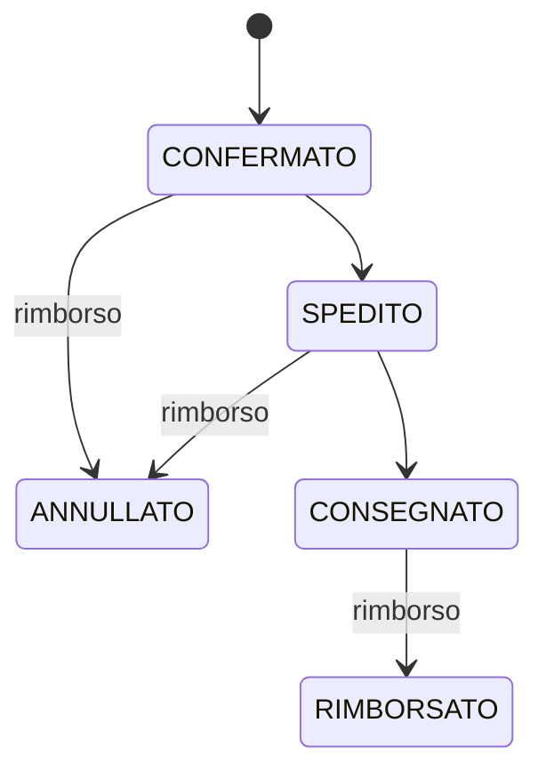

# Schemi di richiesta e risposta

"Obbl." indica se il campo è obbligatorio nella richiesta, o sempre presente nella risposta.

## Utenti e autenticazione

| Schema | Campo | Tipo | Obbl. | Vincoli |
|--------|-------|------|-------|---------|
| `UserCreate` | `nome` | stringa | sì | - |
| `UserCreate` | `cognome` | stringa | sì | - |
| `UserCreate` | `email` | stringa | sì | formato email, univoca |
| `UserCreate` | `password` | stringa | sì | - |
| `UserCreate` | `indirizzo` | stringa o null | no | - |
| `UserRead` | `id` | intero | sì | - |
| `UserRead` | `nome`, `cognome` | stringa | sì | - |
| `UserRead` | `email` | stringa | sì | formato email |
| `UserRead` | `ruolo` | stringa | sì | deve essere valore di `UserRole` |
| `UserRead` | `indirizzo` | stringa o null | sì | - |
| `UserRead` | `saldo` | float | sì | - |
| `UserUpdate` | `nome`, `cognome`, `indirizzo` | stringa o null | no | - |
| `AdminUpdate` | `nome`, `cognome`, `indirizzo` | stringa o null | no | - |
| `AdminAddSaldo` | `saldo` | float | sì | minimo 0  |
| `Token` | `access_token` | stringa | sì | - |
| `Token` | `token_type` | stringa | sì | - |

## Valori per `UserRole`
| Tipo | Valore |
|--------|-------|
| `UserRole.ADMIN` | amministratore |
| `UserRole.STANDARD` | utente base |

## Prodotti e recensioni

| Schema | Campo | Tipo | Obbl. | Vincoli |
|--------|-------|------|-------|---------|
| `ProductCreate` | `nome` | stringa | sì | - |
| `ProductCreate` | `descrizione` | stringa o null | no | - |
| `ProductCreate` | `prezzo` | float | sì | - |
| `ProductCreate` | `giacenza` | intero | sì | - |
| `ProductRead` | `id` | intero | sì | - |
| `ProductRead` | `nome` | stringa | sì | - |
| `ProductRead` | `descrizione` | stringa o null | sì | - |
| `ProductRead` | `prezzo` | float | sì | - |
| `ProductRead` | `giacenza` | intero | sì | - |
| `ProductRead` | `valutazione_media` | float o null | sì | compresa tra 1 e 5 |
| `ProductUpdate` | `nome`, `descrizione`, `prezzo`, `giacenza` | come in `ProductCreate`, ma nullable | no | - |
| `ProductAddGiacenza` | `giacenza` | intero | sì | la quantità da aggiungere non può essere negativa |
| `ReviewCreate` | `valutazione` | intero | sì | da 1 a 5 |
| `ReviewCreate` | `commento` | stringa o null | no | - |
| `ReviewRead` | `id`, `user_id`, `product_id` | intero | sì | - |
| `ReviewRead` | `valutazione` | intero | sì | - |
| `ReviewRead` | `commento` | stringa o null | sì | - |
| `ReviewUpdate` | `valutazione` | intero o null | no | da 1 a 5 se presente |
| `ReviewUpdate` | `commento` | stringa o null | no | - |

## Codici sconto

| Schema | Campo | Tipo | Obbl. | Vincoli |
|--------|-------|------|-------|---------|
| `DiscountCodeCreate` | `codice` | stringa | sì | univocità |
| `DiscountCodeCreate` | `percentuale` | intero | sì | da 5 a 25 |
| `DiscountCodeCreate` | `attivo` | booleano | no | default: `true` |
| `DiscountCodeRead` | `id` | intero | sì | - |
| `DiscountCodeRead` | `codice` | stringa | sì | - |
| `DiscountCodeRead` | `percentuale` | intero | sì | - |
| `DiscountCodeRead` | `attivo` | booleano | sì | - |
| `DiscountCodeUpdate` | `codice` | stringa o null | no | - |
| `DiscountCodeUpdate` | `percentuale` | intero o null | no | da 5 a 25 se presente |
| `DiscountCodeUpdate` | `attivo` | booleano o null | no | - |

## Ordini

| Schema | Campo | Tipo | Obbl. | Vincoli |
|--------|-------|------|-------|---------|
| `CheckoutItem` | `product_id` | intero | sì | - |
| `CheckoutItem` | `quantita` | intero | sì | richiede un valore maggiore di zero |
| `CheckoutRequest` | `items` | lista di `CheckoutItem` | sì | rifiuta il carrello vuoto |
| `CheckoutRequest` | `codice_sconto` | stringa o null | no | - |
| `OrderItemRead` | `id`, `product_id`, `quantita` | intero | sì | - |
| `OrderItemRead` | `prezzo_unitario` | float | sì | - |
| `OrderRead` | `id`, `user_id` | intero | sì | - |
| `OrderRead` | `totale` | float | sì | totale dopo lo sconto |
| `OrderRead` | `stato` | stringa |     ANNULLATO --> [*]
| `OrderRead` | `codice_sconto` | stringa o null | sì | - |
| `OrderRead` | `items` | lista di `OrderItemRead` | sì | - |
| `OrderStatusUpdate` | `stato` | stringa | sì | l'aggiornamento deve essere tra i consentiti |

## Transizioni di stato valide per un ordine

Lo stato di un ordine può cambiare solo secondo le transizioni mostrate qui sotto.

